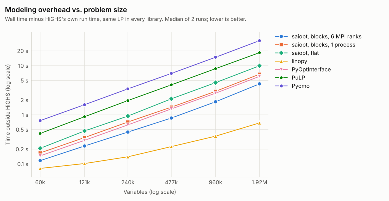

# saiopt
Structured Algebraic Interface for Optimization

A C++20 algebraic modeling library for LP/MILP. The core library is
solver-agnostic: it only depends on the abstract `Solver` interface and a
name-based factory (`saiopt/solver.hpp`), and any backend can implement
it and register itself under a name -- no HiGHS-specific (or any other
backend's) header required to use one. `saiopt_highs` ships one such
backend, registered as `"highs"`, built on [HiGHS](https://highs.dev/)
(linked via its C API). `saiopt_scip` ships another, registered as
`"scip"`, built on [SCIP](https://scipopt.org/) (linked via its C API)
with [SoPlex](https://soplex.zib.de/) as its LP solver.

## Documentation

Documentation is available [here](https://hideakiv.github.io/saiopt/):
step-by-step guides with examples for
[Python](https://hideakiv.github.io/saiopt/python/) and
[C++](https://hideakiv.github.io/saiopt/cpp/).

To build them locally with [Sphinx](https://www.sphinx-doc.org/):

```sh
pip install -r docs/requirements.txt
sphinx-build -b html docs/python docs/python/_build/html
sphinx-build -b html docs/cpp docs/cpp/_build/html
```

## Building

```sh
cmake -S . -B build
cmake --build build -j
```

This fetches and builds Catch2, and HiGHS for the `saiopt_highs` backend
(unless configured with `-DSAIOPT_WITH_HIGHS=OFF`), as part of the
configure step. It also fetches and builds SoPlex and SCIP for the
`saiopt_scip` backend (unless configured with `-DSAIOPT_WITH_SCIP=OFF`).
It also looks for an MPI implementation and builds `saiopt_mpi` (see
[MPI](#mpi) below) unless configured with `-DSAIOPT_WITH_MPI=OFF`.

Run the tests:

```sh
./build/tests/saiopt_tests
```

Run an example:

```sh
./build/examples/diet_problem
```

Other examples: `blocks_basics`, `indexed_macros`, `hierarchical_facilities`,
`transportation`, `solver_mutation`, `jagged_index`, and `variable_lookup`
-- see `examples/` for what each demonstrates.

## Python

`pip install .` builds the `saiopt` Python package (Python 3.9+): the C++
library, both backends, and HiGHS/SCIP themselves, linked into one
extension module with nanobind. The first build compiles HiGHS and SCIP
and takes a while; later ones reuse `build-python/`. Run its tests with
`pip install .[test]` and then `pytest`.

The Python API mirrors the C++ one -- `add_var`/`add_vars`,
`add_constraint`/`add_constraints`, `add_block`/`add_blocks`, the same
lookups, `create_solver`, `Solver`, `SolveResult` -- with keyword
arguments in place of the macros' designated initializers:

```python
import itertools
import saiopt as so

model = so.Model()
arcs = list(itertools.product(["W1", "W2"], [1, 2]))
ship = model.add_vars("ship", arcs, bounds=(0, so.inf))  # dict: key -> Variable
model.add_constraints("demand", [1, 2], lambda c: ship["W1", c] + ship["W2", c] >= 5)
model.set_objective(so.ObjectiveSense.Minimize, so.quicksum(ship.values()))

solver = so.create_solver(model, "highs", {"time_limit": 30.0})
result = solver.solve()
print(result.status, result.objective_value, result.values(ship))
```

A few things differ from C++, because Python works differently:

- A two-sided range is `so.Constraint(expr, lower, upper)`. Python
  evaluates `lower <= expr <= upper` as two separate comparisons joined
  by `and`, which can't be one constraint -- so a constraint has no truth
  value, and that spelling raises instead of silently dropping a bound.
- `x == y` builds a constraint, but its truth value is whether `x` and `y`
  are the same variable, so `Variable` still works as a dict key. Use
  `x.is_same(y)` to compare two handles directly.
- Use `so.quicksum(terms)` for long sums: the built-in `sum()` copies the
  running total on every addition. `expr += term` also adds in place.
- `add_block(name, block)` moves `block` into the parent; the old handle
  can't be used afterward, and the call returns a handle to the attached
  child instead (as does `parent.block(name)`).
- Index keys can be any mutually comparable Python values (tuples for
  multi-dimensional ones), named `name[key]` the same way C++ names them.
- `so.inf` (`1e30`) is saiopt's infinite bound; `math.inf` is accepted too.
- `solve()` releases the GIL. A progress callback may return `None` to
  keep going, and an exception it raises stops the solve and is re-raised
  from `solve()`.

`saiopt.mpi` (with `pip install .[mpi]`, which adds mpi4py) is the Python
counterpart of `saiopt_mpi`: `send_block(block, dest, tag=0, comm=None)`,
`recv_block(source=ANY_SOURCE, tag=ANY_TAG, comm=None)`, and
`gather_blocks(block, root=0)`, which collects every rank's Block on
`root` in rank order. A Block travels as the same raw `MPI_BYTE` message
the C++ functions send, so Python and C++ ranks can exchange Blocks in one
job. See `python/examples/mpi_parallel_build.py`, the port of the C++
example:

```sh
mpiexec -n 4 python python/examples/mpi_parallel_build.py
```

Importing `saiopt.mpi` initializes MPI (through mpi4py), and some MPI
builds -- MPICH over libfabric, for one -- then abort the process on any
`fork()`, including the one `subprocess` uses. Start subprocesses before
importing it.

## MPI

`Block::serialize()`/`Block::deserialize()` turn a `Block` (with its whole
subtree of variables, constraints, objective, and attached children) into a
flat byte buffer and back, rebuilding via the ordinary public API on the
receiving side so it gets fresh, locally-unique `BlockId`s regardless of
what the sending process's were. `saiopt_mpi` (`saiopt/mpi.hpp`) wraps that
in `saiopt::mpi::send_block`/`recv_block`, for constructing a Model's Block
tree across MPI ranks in parallel -- each rank builds its own Block(s)
independently, then sends them to a coordinating rank to attach and solve.
See `examples/mpi_parallel_build.cpp`:

```sh
mpirun -n 4 ./build/examples/mpi_parallel_build
```

## Example

`SAIOPT_VAR`/`SAIOPT_CONSTRAINT` (and their indexed forms `SAIOPT_VARS`/
`SAIOPT_CONSTRAINTS`, plus `SAIOPT_BLOCK[_SCALED]`/`SAIOPT_BLOCKS[_SCALED]`
for attaching sub-models) derive both a local C++ variable's name and its
`saiopt` lookup name from one identifier, so `model.var("bread")` later
doesn't need `"bread"` repeated as a separate string literal -- and
`model.vars("open", regions)` (and, the same way, `model.constraints("cap",
regions)` and `model.blocks("region", regions)`) looks up a whole
`SAIOPT_VARS`/`SAIOPT_CONSTRAINTS`/`SAIOPT_BLOCKS`-declared group at once
(an `Indexed<K, Variable>`/`Indexed<K, ConstraintRef>`/`Indexed<K, Block*>`,
same shape as `open`/`cap`/`region` themselves), for code that only has
the `Model`/`Block` and not the original handle those macros returned. A
declared group is also remembered by name on the `Model`/`Block` itself,
retrievable without the index at all: `model.vars<std::string>("open")`
gives back that same `Indexed<K, Variable>` (`K` has to be named
explicitly -- it can't be deduced from the name alone), while
`model.vars("open")` gives back a plain `std::vector<Variable>` in
declaration order, for when even `K` isn't known. Both throw
`std::runtime_error` for a name nothing was declared under; the typed
form also throws if `K` doesn't match how the group was actually
declared (see `examples/variable_lookup.cpp`). `SAIOPT_OBJECTIVE`
rounds this family out as a thin wrapper around `set_objective` -- there's no
name to derive there, so it's only for keeping every declaration in a model
written the same way:

```cpp
#include "saiopt/macros.hpp"
#include "saiopt/model.hpp"
#include "saiopt/solver.hpp"

using namespace saiopt;

Model model;
SAIOPT_VAR(model, bread);   // kind defaults to Continuous, bounds to unbounded
SAIOPT_VAR(model, milk);

SAIOPT_OBJECTIVE(model, ObjectiveSense::Minimize, 2.0 * bread + 3.0 * milk);
SAIOPT_CONSTRAINT(model, protein, 4.0 * bread + 8.0 * milk >= 20.0);
SAIOPT_CONSTRAINT(model, calories, 100.0 * bread + 150.0 * milk >= 400.0);

auto solver = create_solver(model, "highs");
SolveResult result = solver->solve();
```

An objective may also be quadratic: multiplying two linear expressions
gives a `QuadraticExpression`, which `set_objective` (and
`SAIOPT_OBJECTIVE`) accepts anywhere a linear one goes -- on the root or
on any sub-block, scaled by its multiplier like any other contribution.
Constraints stay linear, so `x * y <= 3` doesn't compile:

```cpp
SAIOPT_OBJECTIVE(model, ObjectiveSense::Minimize, (x - 2.0) * (x - 2.0) + 3.0 * x * y);
```

`"highs"` solves a convex quadratic objective (concave when
maximizing) with continuous variables only: it throws for one with any
integer variable, and since it doesn't check convexity, a nonconvex one
can come back labeled optimal at a mere stationary point. `"scip"`
solves any quadratic objective to global optimality, with or without
integer variables.

`SAIOPT_VAR`/`SAIOPT_VARS` never spell out a `VariableDef` -- `kind` and
`bounds` are optional, keyword-style (C++20 designated initializers),
independent of each other:

```cpp
SAIOPT_VAR(model, x, .bounds = {0.0, 6.0});                  // continuous, bounded
SAIOPT_VAR(model, flag, .kind = VarKind::Binary);            // binary
SAIOPT_VARS(model, open, regions, .kind = VarKind::Binary);  // uniform across the whole index

// `bounds` on SAIOPT_VARS may also be a per-key lambda, looked up by key
// (not a parallel vector, which could drift out of sync with `index`):
SAIOPT_VARS(model, x, foods,
            .bounds = [&](const std::string& k) { return std::tuple{0.0, cap.at(k)}; });
```

See `saiopt/var_spec.hpp` for the two spec types behind this.

`create_solver(model, name)` looks up the backend registered under `name`
(linking `saiopt_highs` registers `"highs"`, `saiopt_scip` registers
`"scip"`; writing your own backend is just implementing `Solver` and
registering it -- see `saiopt/solver.hpp`)
and translates `model` into that backend's native form once, handing back
a `Solver` you keep and call `solve()` on. Calling `solve()` again reuses
that same translated state rather than re-flattening the Block tree, so
it's cheap to solve the same model repeatedly. None of this needs a
HiGHS-specific header, so swapping backends never touches `Model` or the
rest of the modeling code.

An optional third argument passes backend-specific settings, keyed by
the backend's own option names -- saiopt doesn't interpret them, the
backend does, so any option its native API supports works without
saiopt needing to know about it in advance:

```cpp
auto solver = create_solver(model, "highs",
    SolverOptions{}.set_double("time_limit", 30.0).set_double("mip_rel_gap", 0.01));
```

`SolverOptions` has one setter per value type (`set_bool`/`set_int`/
`set_double`/`set_string`) mirroring HiGHS' own segregated
option-setting API; passing a name or value a backend rejects throws
`std::runtime_error` when the `Solver` is constructed. See HiGHS' own
documentation for its full option list (e.g. `time_limit`,
`mip_rel_gap`, `presolve`, `threads`, `output_flag`). `ScipSolver` uses
this the same way, but keyed by SCIP's own parameter names instead
(e.g. `limits/time`, `limits/gap`, `limits/nodes`) -- `set_int` is
tried against both SCIP's int- and Longint-valued parameters, since
`SolverOptions` doesn't distinguish the two the way SCIP does.

`result.status` says how the solve ended, as a `SolveStatus` each
backend maps its own native status onto -- `Optimal`, `Infeasible`,
`Unbounded`, `InfeasibleOrUnbounded`, a limit (`TimeLimit`,
`IterationLimit`, `NodeLimit`, `SolutionLimit`, `GapLimit`,
`ObjectiveLimit`, `MemoryLimit`), `Interrupted`, `Error`, or `Unknown`
(`to_string` gives a readable name). A solve that stops early can still
leave a feasible solution behind -- e.g. a MIP that hits its time limit
with an incumbent -- so whether there's one to read is a separate
`result.has_solution`; `objective_value` and `value(...)` are only
populated when it's true:

```cpp
SolveResult result = solver->solve();
if (result.optimal()) {
    // proven optimal
} else if (result.has_solution) {
    // feasible but unproven, e.g. result.status == SolveStatus::TimeLimit
} else {
    std::printf("no solution: %s\n", std::string(to_string(result.status)).c_str());
}
```

`solver->set_progress_callback(...)` registers a callback that fires
periodically during `solve()` with a `SolverProgress` snapshot
(elapsed time, iteration count, objective value, and -- for a MIP
search -- best bound/gap/node count as `std::optional`s, unset outside a
MIP). Returning `false` requests the solve stop early:

```cpp
auto solver = create_solver(model, "highs");
solver->set_progress_callback([](const SolverProgress& p) {
    std::printf("t=%.1fs obj=%.2f\n", p.elapsed_seconds, p.objective_value);
    return p.elapsed_seconds < 30.0;  // stop after 30 seconds
});
SolveResult result = solver->solve();  // status is Interrupted if stopped early
```

An interrupted `Solver` isn't guaranteed to behave like a fresh one if
you call `solve()` on it again -- `HighsSolver` in particular leaves the
underlying HiGHS instance stuck reporting the interrupt on every
subsequent `solve()` (confirmed against HiGHS 1.15.1; neither clearing
the callback nor HiGHS' own solver/model reset calls un-stick it).
Build a new `Solver` via `create_solver` for a clean re-attempt.
`ScipSolver` doesn't have this problem -- an interrupted instance
resolves cleanly from scratch on its next `solve()` (confirmed against
SCIP 8.0.1).

`Solver` also carries coefficient/bound/kind get/set methods that used
to live on `Model` -- `objective_coefficient`/`set_objective_coefficient`,
`constraint_coefficient`/`set_constraint_coefficient`,
`constraint_lower`/`set_constraint_lower`,
`constraint_upper`/`set_constraint_upper`, `variable_lower`/
`set_variable_lower`, `variable_upper`/`set_variable_upper`, and
`variable_kind`/`set_variable_kind` -- but they now act directly on the
backend's live state (e.g. `HighsSolver` calls straight into HiGHS' own
change-coefficient API) instead of the `Model` tree, so a change takes
effect on the *next* `solve()` with no re-flattening either:

```cpp
auto solver = create_solver(model, "highs");
SolveResult r1 = solver->solve();

solver->set_objective_coefficient(bread, 4.0);  // reprice, no re-flatten
SolveResult r2 = solver->solve();
```

See `examples/solver_mutation.cpp` for all of these in one walkthrough.

For an LP, `SolveResult` carries duals and reduced costs. Sensitivity
ranging (`objective_coefficient_ranges`, `variable_bound_ranges`,
`constraint_bound_ranges`) is opt-in, since it's a noticeable share of
each solve on a large model: call `solver->set_sensitivity_ranging(true)`
first.

`solver->write_model(path)` writes the `Solver`'s current model --
including any changes made through those setters -- to a file, in the
format `path`'s extension names. Both backends write `.lp` (CPLEX LP)
and `.mps` (free MPS); `ScipSolver` also writes any other format SCIP's
own plugins can (e.g. `.cip`). Variables and constraints keep their
qualified names, rewritten into identifiers the formats accept (see
`file_safe_names` in `saiopt/sparse_lp.hpp`) -- `sub.x[(a, 1)]` is
written as `sub.x((a,1))`:

```cpp
auto solver = create_solver(model, "highs");
solver->write_model("model.lp");  // throws if the extension isn't supported
```

`solver->set_initial_solution(values)` gives the next `solve()` a
starting point (a MIP start) -- values for some or all variables, which
the backend completes into a feasible solution if it can and starts its
search from. It's only a hint, so a start that can't be completed is
dropped rather than reported as an error; a value outside its
variable's bounds (beyond a small tolerance) or one for a variable from
another model throws. Passing a previous result's values back in is the
common case -- e.g. re-solving after repricing, which leaves the old
solution feasible:

```cpp
SolveResult r1 = solver->solve();
solver->set_objective_coefficient(open_site, 120.0);
solver->set_initial_solution(r1.variable_values);  // start from the old plan
SolveResult r2 = solver->solve();
```

## Performance

How much time a modeling layer adds on top of the solver, measured from
Python on one LP at sizes from 60k to 1.92M variables: 24 regions, each
an N x N transportation sub-model, tied together by one linking
constraint. Every library builds the same model the way it's meant to be
used and solves it with HiGHS. The chart shows each run's wall time minus
HiGHS's own logged run time -- building the model, getting it to HiGHS,
and getting the result back -- so solver speed drops out.

This is the same subtraction linopy's
[JOSS paper](https://doi.org/10.21105/joss.04823) uses for its overhead
benchmark. It differs from the zero-time-limit method of the
[JuMP 1.0 paper](https://arxiv.org/abs/2206.03866) and
[PyOptInterface's benchmark](https://metab0t.github.io/PyOptInterface/benchmark.html),
which stop the solver immediately and so measure only building the model
and handing it over: here every run solves for real, so the time also
includes returning the solution -- copying values (and duals) back into
each library's own objects. That costs most where values are written
into a Python object per variable (Pyomo, PuLP), and little where they
are fetched on demand or as arrays (PyOptInterface, linopy). Numbers
here aren't directly comparable with those papers' tables.

<picture>
  <source media="(prefers-color-scheme: dark)" srcset="docs/benchmark-overhead-dark.svg">
  
</picture>

Time outside HiGHS, in seconds (median of 2 runs):

| Setup | 60k | 121k | 240k | 477k | 960k | 1.92M |
|---|---:|---:|---:|---:|---:|---:|
| saiopt, blocks, 6 MPI ranks | 0.12 | 0.23 | 0.45 | 0.86 | 1.84 | 4.26 |
| saiopt, blocks, 1 process | 0.17 | 0.34 | 0.71 | 1.43 | 3.01 | 6.70 |
| saiopt, flat | 0.21 | 0.47 | 0.94 | 2.12 | 4.51 | 9.94 |
| linopy | 0.08 | 0.10 | 0.14 | 0.23 | 0.37 | 0.68 |
| PyOptInterface | 0.15 | 0.30 | 0.62 | 1.32 | 2.75 | 6.06 |
| PuLP | 0.42 | 0.91 | 1.95 | 4.07 | 8.70 | 18.41 |
| Pyomo | 0.76 | 1.61 | 3.37 | 6.95 | 14.84 | 32.29 |

- **saiopt, flat** builds the whole model in one `Model`, keyed by
  `(k, i, j)`. **saiopt, blocks** builds each region as its own `Block`
  keyed by `(i, j)` and attaches it -- the same LP, and faster even in a
  single process, because each indexed group stays small. With
  `saiopt.mpi`, ranks build their regions in parallel and rank 0 gathers
  them before solving.
- linopy builds from whole arrays rather than one expression per
  constraint, so it scales differently from everything else here;
  saiopt's place is between it and the expression-based libraries, with
  composable blocks, name-based lookup, and MPI on top.
- Not included: highspy, which is HiGHS's own interface rather than a
  solver-independent modeling library, and python-mip, which can't use
  HiGHS.

Measured on an AMD Ryzen 9 9900X (12 cores) under WSL2, Python 3.12, with
HiGHS 1.15.1 (saiopt, PyOptInterface) or 1.16.0 (the rest), linopy 0.10,
PyOptInterface 0.6, PuLP 4.2, and Pyomo 6.10 (its appsi HiGHS
interface). HiGHS logs its run time to the nearest 10 ms, so the smallest
sizes carry a little rounding noise. To reproduce, with saiopt installed
as `saiopt[mpi]` alongside those libraries (and matplotlib, for the chart):

```sh
cd benchmarks/python
python run.py      # writes results.csv; see --help for sizes, ranks, reps
python plot.py     # redraws docs/benchmark-overhead-{light,dark}.svg, prints the table
```
